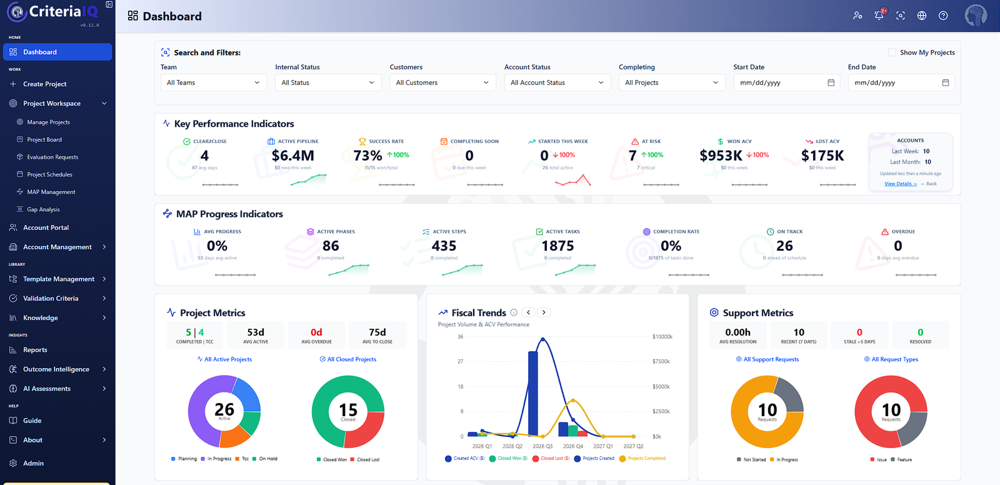
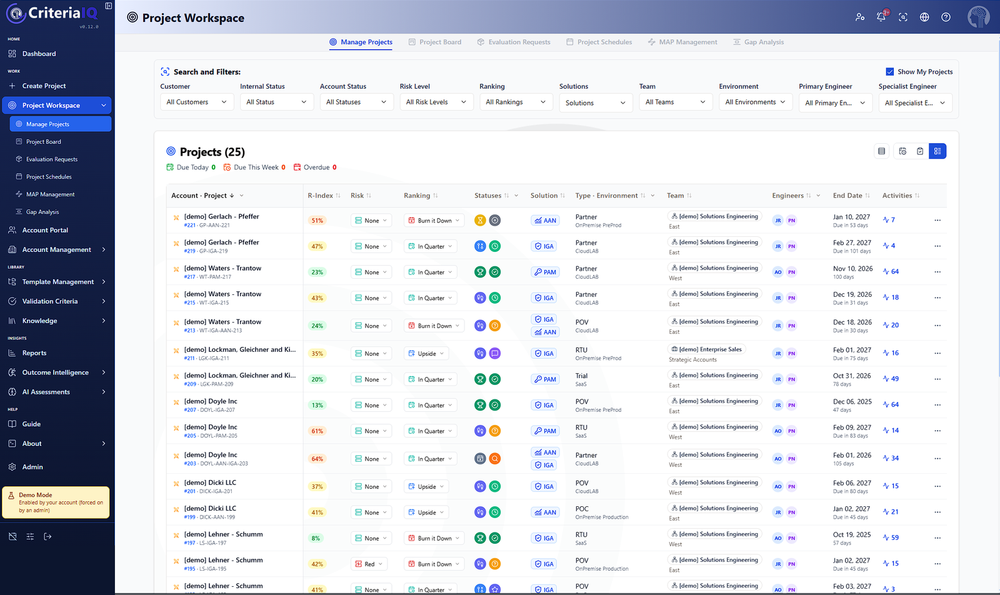

# CriteriaIQ Technical Validation

> A full-stack platform for  Presales | Sales | Solution Engineers to run structured technical validation projects (POx), align customers to outcomes, and produce defensible Technical Clearance to Close (TCC) recommendations.

---

## Overview

CriteriaIQ is a purpose-built workspace for Presales | Sales | Solution Engineers managing enterprise cybersecurity technical validation projects. It replaces fragmented spreadsheets, email threads, and manual tracking with a unified platform that automates workflows, surfaces AI-driven risk insights, and keeps every stakeholder — internal and external — aligned in real time.

The platform follows the **5A Framework** (Attach → Assess → Affect → Align → Acquaint) and the **Clear2Close validation lifecycle**, guiding engineers through every stage from initial project scoping and success criteria definition, through mutual action planning, proof execution, and gap analysis, to closure intelligence and handoff.

---

## Who It's For

| Stakeholder | How CriteriaIQ Helps |
|-------------|----------------------|
| **Sales/Solution Engineers** | Primary Workspace — manage validation projects with structured workflows, AI analysis, and real-time tracking |
| **Specialist Engineers** | Collaborative execution on assigned projects with full criteria and artifact access |
| **Opportunity Owners / Sales** | Real-time project status, pipeline visibility, and customer engagement metrics |
| **Customer Success** | Validation outcome visibility, handoff quality tracking, and expansion signal data |
| **Product Management** | Aggregated analytics on validation patterns, gap types, and success criteria trends |
| **Partners** | Dedicated portal access for collaborative validation projects |
| **Customers** | Transparent progress tracking through a dedicated, configurable customer-facing portal |

---

## Screenshots

**Dashboard:** KPIs, MAP progress, project and support metrics, and fiscal trends across your validation pipeline.



**Manage Projects:** every validation project with risk, ranking, status, solution, team, engineers and due dates in one sortable, filterable table.



> Screenshots show Demo Mode data.

---

## Key Features

### Project & Workflow Management
- Guided project creation with customer onboarding, team assignments, and criteria setup
- Project Navigator Drawer for browsing projects without leaving context
- Project Board (Kanban), Project Schedules (calendar), and live status tracking with audit trail
- Gap Analysis System — track feature, integration, performance, scalability, and documentation gaps with MoSCoW criticality ratings

### Mutual Action Plan (MAP)
- Structured MAP system with Phases, Steps, and Tasks
- Auto-initialization from templates, real-time updates, cascading assignments, and milestone tracking
- MAP Library with reusable templates organized by engagement type and solution

### Assumptions & Dependencies
- Global Assumptions register — capture, categorize, and track project assumptions by status (Open, Confirmed, Violated, Accepted), owner, and due date
- Global Dependencies Registry — log internal and external dependencies with 6-status lifecycle (Open, In Review, Resolved, Fail, Blocked, Inconclusive) and searchable owner filter
- Integrated into the Clear2Close validation lifecycle across all 4 stages

### Success Criteria & Value Mapping
- Full criteria hierarchy: Solution → Component → Value Mapping → Criteria → Expected Outcome → Action Taken
- Criteria Builder with guided stepper and reusable library across projects
- Value Mapping to align technical capabilities directly to customer business outcomes

### Outcome Intelligence
- Technical Clearance to Close (TCC) recommendation system (Pass, Conditional Pass, Fail, Defer)
- Moneyball-style closure metrics: Technical Fit, Political Alignment, Pain Rating, and Reason Codes
- Quadrant Analysis, competitor context capture, and expansion opportunity signals
- Closure intelligence fed back to the SE org and Product team for pattern recognition

### AI-Powered Risk Analysis
- GPT-4o powered risk scoring, predictions, and recommendations
- Configurable risk criteria with visual indicators and weighted scoring
- Support for multiple LLM providers: OpenAI, Gemini, Anthropic, xAI, Azure OpenAI — with encrypted API key storage
- GitHub Documentation Sync for keeping AI assessment context current

### Competitor Intelligence
- Technology space and competitor mapping per project
- Competitor artifact management and deal-context tracking

### Account Portal
- Customer-facing portal for stakeholder engagement — no internal system access required
- Configurable content visibility: success criteria progress, shared resources, and project milestones
- Partner portal access for collaborative validations

### Email & Communication Automation
- Rule-based workflow automation with email, webhook, and Salesforce triggers
- Scheduled tasks with full run history and manual trigger capability
- Outbound Webhook System (MS Teams, Slack, generic HTTP) with HMAC-SHA256 signing and exponential backoff retry
- Rich email template system with design editor

### Analytics & Reporting
- KPI Dashboard with customizable widgets and metric snapshots
- Custom Report Builder and Dashboard Builder with drag-and-drop layout
- Leading indicator tracking: time to kickoff, time to first proven use case, gap counts, TCC probability

### Salesforce Integration
- User-context OAuth with encrypted token storage
- Configurable bidirectional field mapping and sync policies

### Security & Access Control
- Role-based access control (RBAC) with hierarchical sub-section permissions
- Multi-factor authentication: TOTP, WebAuthn (passkeys), encrypted recovery codes
- Trusted device management, AES-256-GCM encryption, CSRF protection
- Dev Persona Switcher — admin-only role simulation mode for previewing role-based UI in read-only View Mode

### Administration
- Archive Management System (soft-delete with restore for users, projects, customers)
- System Health Monitoring Dashboard (database, email, integrations, security, storage, performance)
- Universal Status, Risk Level, and Ranking configuration
- Announcement system, Flight Deck modal, Global Search (Ctrl+K command palette)
- Multi-language support: English, French, German, Spanish, Portuguese, Italian

---

## Clear2Close Validation Lifecycle

CriteriaIQ includes a built-in **Clear2Close** operational guide covering the full 4-stage validation lifecycle for Solution Engineers:

| Stage | Name | Purpose |
|-------|------|---------|
| 1 | Define the Proof and Attach | Align business problem, use cases, stakeholders, success criteria, and assumptions |
| 2 | Assess the Validation | Build runnable environment, establish readiness, load the MAP |
| 3 | Affect the Validation | Execute the proof, document evidence, manage risk, track gaps and A&D in real time |
| 4 | Align, Acquaint, & Expand | Deliver TCC recommendation, produce handoff, capture closure intelligence and expansion signals |

Each stage includes entrance and exit criteria, required artifacts with direct in-app links, escalation rules, ownership mapping, and team responsibilities — all accessible from the About → Clear2Close tab.

---

## Tech Stack

| Layer | Technologies |
|-------|-------------|
| **Frontend** | React 19, TypeScript 6, Vite 8, Tailwind CSS 4 (CSS-first via `@theme`), shadcn/ui, TanStack Query, Wouter, React Hook Form 7 + Zod 4 |
| **Rich Text & Charts** | Tiptap 3 (Markdown storage), TinyMCE 8, Recharts |
| **Real-time** | WebSocket Manager (singleton, auto-reconnect, event deduplication) |
| **Backend** | Node.js, Express 5, TypeScript 6, ES modules |
| **Database** | PostgreSQL (Neon serverless), Drizzle ORM (16 domain-based schema files) |
| **Authentication** | bcryptjs, TOTP (otplib), WebAuthn / Passkeys (@simplewebauthn), AES-256-GCM, encrypted recovery codes |
| **Email** | Nodemailer (SMTP) |
| **Storage Backends** | Local FS, AWS S3 (`@aws-sdk/client-s3`), Azure Blob (`@azure/storage-blob`), Google Cloud Storage |
| **Integrations** | Salesforce (jsforce), Puppeteer (PDF), Handlebars (templating) |
| **i18n** | i18next 26 / react-i18next 15 (6 languages, ratcheting allowlist gate) |

---

## Codebase Architecture

A few architectural decisions worth flagging before navigating the source:

- **Schema is split into 16 domain files** under `shared/schema/`, exported through a barrel (`shared/schema/index.ts`). All application code imports from `@shared/schema` — never from individual domain files. See `PROJECT_REFERENCE.md` → "Adding New Database Tables" for the picker.
- **Storage layer is composed from 28 domain mixins** under `server/storage/` (Phase 7 split). `server/storage.ts` is now a thin composition shell — every method comes from a `*StorageMixin` class wired in via interface declaration-merge plus a runtime `applyMixins(...)` call. Add new methods to the matching mixin, not to `storage.ts` itself. The mixin contract is locked by `server/storage/__tests__/mixin-composition.test.ts`. See `PROJECT_REFERENCE.md` → "Storage Layer Composition" for the pattern.
- **Soft-delete archive mirror rule:** every column added to `users`, `projects`, `customers`, `activity_logs`, or `customer_access` MUST also be added to the corresponding `archived_*` table in `shared/schema/archive.ts` (plus a SQL `ALTER TABLE` migration). The archive logic uses `...spread`, so a missing column silently drops the value on archive→restore round-trip. The `archive-restore-roundtrip.test.ts` test catches drift automatically.
- **Demo Mode** (Admin sandbox) flows through `req.demoMode` resolved by middleware in `server/lib/demo-mode.ts`, with `applyDemoFilter(table)` from `server/lib/demo-storage.ts` wiring tagged tables (customers, projects, tags, products, email templates, custom reports, dashboard layouts, MAP templates, etc.) so demo and production sessions never see each other's rows. See `docs/admin/demo-mode.md`.
- **Build pipeline enforces 15 lint gates** before vite/esbuild — toasts, apiRequest JSON parsing, version markers, Traefik labels, dokploy app labels, healthcheck, slow-save threshold + payload, db pool, proxy timeouts, self-hosting traefik, heavy imports, i18n coverage, doc dates, and schema-vs-migration snapshot. Pre-push runs `npm run check` (tsc) via a Husky hook.

---

## Quick Start

The fastest way to run CriteriaIQ is Docker Compose, which starts the app and a Postgres 16 database:

```bash
git clone https://github.com/egarlepp/criteriaiq.git
cd criteriaiq
docker compose up -d --build
```

Open http://localhost:5000 and follow the first-run setup wizard at `/setup`. It generates the session and encryption secrets, creates the first admin, and stores its settings in the `app_data` volume. For production installs (reverse proxy, TLS, backups, environment variables), see [`docs/guides/self-hosting.md`](docs/guides/self-hosting.md) and [`.env.example`](.env.example).

For local development without Docker, see [`docs/guides/local-dev-setup.md`](docs/guides/local-dev-setup.md).

## Project Status

CriteriaIQ is in **beta** (see [`version.json`](version.json) for the current version). Expect breaking changes between minor versions until 1.0, and back up your database before upgrading.

---

## Build & Type-Check Contract

CriteriaIQ is designed to self-host on a small VPS (4 GB RAM is enough). To keep deploys fast on that footprint, the production build and the TypeScript type-check are split into two scripts:

| Command | What it does | When to run |
|---------|--------------|-------------|
| `npm run check` | `tsc --extendedDiagnostics` (~70 s, needs ~2.4 GB RAM) | **Before every push.** A Husky `pre-push` hook runs this automatically — see below. |
| `npm run build` | Lints + `vite build` + `esbuild` + runtime-docs bundle + bundle verifier (~20 s, low memory) | What the Docker builder runs in production. **Does NOT type-check** — that's the developer's job before pushing. |
| `npm run build:typed` | `npm run check && npm run build` | Use on a beefy machine when you want one command that produces a type-checked production bundle (CI runners, dev machines with ≥8 GB RAM). |

### Pre-push hook

A Husky `pre-push` hook is wired up to run `npm run check` automatically before each `git push`. It's installed for everyone on `npm install` (via the `prepare` script), so a fresh clone gets the hook with no extra steps.

If you genuinely need to push code that doesn't type-check (a known-broken WIP branch, an emergency revert, etc.), bypass the hook with:

```bash
git push --no-verify
```

Use the bypass sparingly — the whole point of the hook is to keep broken types out of the Docker builder, where catching them costs ~14 minutes of swap-thrashed compile time instead of ~70 seconds locally.

## Documentation

Architecture decisions, development guidelines and schema organization are in:

- [`PROJECT_REFERENCE.md`](PROJECT_REFERENCE.md) — Conventions and architecture reference at the repo root.
- [`docs/plans/backlog.md`](docs/plans/backlog.md) — Ideas and deferred follow-ups that are not scheduled yet.
- [`CLAUDE.md`](CLAUDE.md) — Onboarding for Claude Code / AI assistants working on this codebase. Reading order, conventions, lint-gate awareness, and the deferred-work backlog.
- [`docs/guides/`](docs/guides/) — Development guides: deployment, error handling, performance, versioning, language translation, i18n sweep plan, storage-split retrospective, etc.
- [`docs/features/`](docs/features/) — Individual feature documentation (MAP, Gap Analysis, Outcome Intelligence, Webhooks, AI Assessments, Salesforce, and more).
- [`docs/architecture/`](docs/architecture/) — System architecture diagrams and design docs.
- [`docs/admin/demo-mode.md`](docs/admin/demo-mode.md) — Admin Demo Mode operator reference (how to enable, what it isolates, wipe safety).

For i18n contributors specifically, the two relevant docs are [`docs/guides/language-translation.md`](docs/guides/language-translation.md) (the system) and [`docs/plans/i18n-sweep-plan.md`](docs/plans/i18n-sweep-plan.md) (the rollout plan + current `.i18n-allowlist.txt` ratchet).

## Contributing

Bug reports, feature requests and pull requests are welcome. Read [`CONTRIBUTING.md`](CONTRIBUTING.md) before opening a PR, and follow the [Code of Conduct](CODE_OF_CONDUCT.md).

## Security

Please do not report security vulnerabilities in public issues. See [`SECURITY.md`](SECURITY.md) for how to report them privately.

## License

CriteriaIQ is released under the [MIT License](LICENSE.txt). Third-party components keep their own licenses; see [`THIRD_PARTY_NOTICES.md`](THIRD_PARTY_NOTICES.md).
