# CriteriaIQ - Technical Validation Workspace
## Workflow Diagrams

### Document Information
- **Version:** 3.0
- **Date:** February 14, 2026
- **Application Version:** v0.12.0 <!-- @managed-version: written by ./update-version.sh from version.json -->

### Recent Updates (v0.12.0) <!-- @managed-version: written by ./update-version.sh from version.json -->

**Multi-DB Management, Secret Lifecycle & Cleanup Schedulers (v0.7.20)**

**🔒 Security Changes**
- **App-Managed Bootstrap Secrets Workflow (Task #741):** Promote → Bootstrap Secrets card POSTs `/api/system/secrets/promote` → server reads the host-env value, writes the AES-256-GCM-encrypted copy into the app file, flips `source` to `file`. Unmanage → POST `/api/system/secrets/unmanage` (typed-confirm) → server deletes the file copy and falls back to host-env. Reveal-for-10s → POST `/api/system/secrets/reveal-*` → server returns the plaintext, client auto-hides after 10s. All three endpoints are suppressed from access logs.
- **Encryption-Key Rotation Race Workflow (Task #726):** Old key cached in process memory at rotation time; on every decrypt, try new key first, fall back to old key once. Cache is purged after the re-encryption pass commits, eliminating the COMMIT/env-swap race window.
- **Forced Logout Workflow (Task #724, #736):** `SESSION_SECRET` rotation triggers a sweep that destroys every active session row and bumps the cookie name's signing key. Next request sees an invalid cookie, hits `/login` with the "you've been logged out" toast.
- **Rotation Banner Workflow (Task #734):** During encryption-key rotation, `/api/system/secrets/rotation-status` reports `inProgress: true` with progress counters; the React banner polls and renders the live countdown until the rotation commits.
- **Data-Dir Health Probe Workflow (Task #741):** Boot writes a temp file under the data dir; success/failure is cached and re-checked on every `/api/system/health` call so an admin sees a degraded status the moment the mount becomes read-only.

**🆕 New Features**
- **Multi-DB Management Workflow (Task #739):** All connection CRUD goes through the file store at `/data/db-config.json`. Each entry holds the AES-256-GCM-encrypted URL, driver, SSL mode, and timestamps. Editing or deleting a connection requires the operator to type the connection name as confirmation.
- **Set-Active-for-Next-Restart Workflow (Task #740):** POST `/api/db-connections/pending-active` writes the staged connection ID to the file store. On boot, `consumePendingActive()` reads it, swaps to that connection, and clears the slot. DELETE cancels the pending swap.
- **Sessions Cleanup Workflow (Task #737, #745, #752):** Scheduler runs daily and deletes expired session rows from the session store. Last-run snapshot (timestamp, row count, duration) is held in process memory and rendered on the System Health card. Admin "Run now" POSTs `/api/system/health/services/sessions-cleanup/run` to trigger an immediate prune.
- **Login-History Cleanup Workflow (Task #746, #751, #756):** Scheduler runs daily and prunes `audit_logins` rows older than the configured retention window. Admin "Run now" POSTs `/api/admin/audit-logins-cleanup/run` after passing the AlertDialog confirmation (Task #758). Last-run snapshot (Task #757) is persisted to disk so it survives restarts.

**🔧 Improvements**
- **JSON-Parsing Sweep Workflow (Task #754):** Every call site that previously did `JSON.parse(await response.text())` was switched to `await response.json()`. A new lint rule + regression test catches reintroductions in CI; this also unblocked the secret-rotation copy dialog (Task #749).
- **Persistent Cleanup Snapshot Workflow (Task #757):** Audit-logins cleanup writes its last-run snapshot to a JSON file under the data dir; on boot the scheduler reads it back so the admin panel shows accurate state before the next scheduled run.

**🐛 Fixes**
- **Hidden Secret-Rotation Copy Dialog (Task #749):** Broken response parsing was silently swallowing the new-key dialog after a successful rotation; replacing the parse with `response.json()` restored the dialog so admins can copy the freshly minted secret.

### Previous Updates (v0.7.10)

**🔒 Security Changes**
- **Production Secret Hardening Workflow:** Boot sequence now branches on whether an approved admin exists. With an admin present, missing `SESSION_SECRET` / `ENCRYPTION_KEY` triggers a fail-fast exit in production. Without an admin, the bootstrap window auto-generates safe values so first-boot never deadlocks.
- **Setup Route Gating Workflow:** Status-only `/api/setup/status` is always registered. Mutating bootstrap endpoints (`/initialize`, `/create-admin`, `/smtp`, etc.) are conditionally registered only while the bootstrap window is open and rejected with `403` once the system is initialized.

**🆕 New Features**
- **Tiptap Editor Migration Workflow (Task #196):** Editor open → `React.lazy` resolves the Tiptap chunk (`vendor-editors`) on demand → ProseMirror initializes → `tiptap-markdown` parses stored markdown into the document tree → Admonition pre-processor converts `:::type … :::` fences into Admonition nodes. On save, the post-processor re-serializes Admonition nodes back to canonical fences and `tiptap-markdown` writes markdown to the field. Same flow runs across all 9 editor call sites with no API change for callers.
- **Tiptap Round-Trip Test Workflow (Task #204):** Vitest walks 42 markdown fixtures across 8 files (64 tests total with the admonition unit suite) through parse → serialize → re-parse, asserting byte-identical output on the second pass. Catches regressions in admonitions, blocks, lists, marks, media, mentions, tables, and YouTube embeds.
- **First-Run Setup Wizard Workflow:** `/setup` now drives a 7-step state machine (Database → Schema Migration → Admin Seed → Secrets → SMTP → Public URL → Done). Each step calls a dedicated mutation endpoint, validates the response, and advances state. The Done step polls `/api/health` and performs a live `fetch` against `${PUBLIC_APP_URL}/api/health` to confirm round-trip reachability.
- **Smart Auth Redirect Workflow:** `useAuth` intercepts `401` / `503` responses, queries `/api/setup/status`, and redirects uninitialized installs to `/setup` instead of looping at the login screen.
- **Deferred SMTP Hydration Workflow:** `smtp-hydrate.ts` runs on first boot after setup completes, decrypts wizard-supplied SMTP credentials from the DB, and primes the email transport without a manual restart.

**🔧 Improvements**
- **Tiptap Component & File Rename Workflow:** All `Mdx*` editor files and components were renamed to `Tiptap*` (`MdxEditor` → `TiptapEditor`, `MdxField` → `TiptapField`) so import paths and component names match the underlying engine.
- **Tiptap Pre-Bundle / Lazy-Load Workflow:** Tiptap and its plugins are listed in Vite's `optimizeDeps.include` and split into the `vendor-editors` manual chunk; the editor surface is mounted via `React.lazy` + `Suspense`, so the chunk only loads when a card is opened and the initial app payload stays small.
- **Lazy Secret Resolution Workflow:** `getSessionSecret()`, `getEncryptionKey()`, and `getPublicAppUrl()` resolve at call-time, so wizard-written values take effect within the same process instead of requiring a restart.
- **Real DB Probe in Status Workflow:** `/api/setup/status` opens a transient `Pool` against the configured `DATABASE_URL`, executes `SELECT 1` with a short timeout, and returns `dbReachable: true | false` for the wizard to display.

**🐛 Fixes**
- **Editor Cold-Cache 504 Timeout:** Adding Tiptap and its plugins to Vite's `optimizeDeps.include` list ensures the editor chunk is pre-built rather than discovered on first import, eliminating the 504 that fired when opening editor cards on a freshly-loaded page.
- **Admonition Round-Trip with Indented/Nested Fences:** Pre/post-processor now scans for indentation and nested `:::type` blocks and reconstructs them deterministically, preventing data loss on deeply-structured content.
- **Docker-Compose First-Boot Deadlock:** Resolved by the conditional bootstrap-gating workflow described above.

### Previous Updates (v0.7.00)

**🔒 Security Changes**
- **Major Dependency Security Hardening Workflow:** Full stack upgrade across all layers — React 19.2, Express 5.2, TypeScript 6.0, Zod 4.3, Vite 8.0, Drizzle ORM 0.45, Lucide React 1.7, and all Radix UI packages — addressing known CVEs and aligning the platform with current LTS releases.

**🔧 Improvements**
- **Reports Library Redesign Workflow:** Reports section groups entries into My Reports, Other Reports, System Reports, and Inactive Reports collapsible categories, each rendered inside a Card component. Within each category, report cards are displayed in a 4-column CSS grid (`minmax(200px, 1fr)`) that auto-stretches to fill available width.
- **Date Picker Dropdown Navigation Workflow:** Calendar component now renders inline year and month `<select>` dropdowns in the caption bar, replacing the month-by-month arrow buttons. Users can jump directly to any month/year without repeated clicks.
- **Tech Stack Page Refresh Workflow:** Technology Stack card on the Introduction tab updated to list current framework and library versions reflecting the v0.7.00 stack upgrade.

### Older Updates (v0.6.20)

**🆕 New Features**
- **Error Audit Log Sidebar Navigation Workflow:** Admin-only 3rd-level sidebar entry under About → Support & Features triggers URL navigation with `?subtab=error-log`, which syncs to the SupportFeaturesTab internal state via useEffect.

**🔧 Improvements**
- **SubNavPopover Sub-Tab Workflow:** Support & Features page uses SubNavPopover hover-dropdown for switching between "Support Requests" and "Error Audit Log" views. Selection updates both component state and browser URL.
- **SubNavPopover Label Wrapping Fix:** Dropdown labels use `whitespace-nowrap` to prevent long labels from wrapping.

### Previous Updates (v0.6.10)

**🆕 New Features**
- **Validation Criteria Solution Group Workflow:** Criteria section groups entries by solution with collapsible dark purple headers; "Add Criterion" button scoped per group; solution determined at group level — no dropdown inside form.
- **Horizontal Accordion Workflow:** New criterion entry fields rendered as left-to-right icon panels; click to expand one panel at a time; Status + Delete pinned to right; 5 numbered progress circles in header track completion state.
- **WebhookWizardModal Brand Icon Workflow:** Step 1 channel selection redesigned as horizontal card rows with brand-specific inline SVG icons (Teams, Slack, Generic HTTP); checkmark appears on selected card.

**🔧 Improvements**
- **Smart Step Pre-fetch Workflow:** On load, component data is pre-fetched for all selected solutions (not just those with existing criteria); `addCriteria` reads query cache directly for accurate initial step selection.
- **New Criterion Entry Rename:** Header text changed from "New Criteria Entry" to "New Criterion Entry" with light purple background.

### Previous Updates (v0.6.00)

**🆕 New Features**
- **Database Connection Manager Workflow:** Two-layer database management with file-based bootstrap config and DB table management. Activation writes to Layer 1 file and triggers clean restart.
- **Backup Destinations Workflow:** Named backup targets with branch categorization, per-branch defaults, and connection testing stored encrypted in the database.
- **DB Branching Workflow:** Six branch types (Development/Production/Testing/Q&A/Sandbox/Other) with color-coded collapsible card groups and independent per-branch default selections.
- **Setup Wizard Workflow:** Pre-DB `/setup` route handles first-boot configuration using file-based config before any database connection is established.

**🔧 Improvements**
- **Connection Test Workflow:** MonitorCheck button triggers POST test endpoint; result (latency/error) displayed inline and persisted to database for subsequent loads.
- **Branch-Grouped Display Workflow:** Accordion-style branch group headers with item counts; cards carry branch color and icon; collapsible per-group.
- **Deletion Guard Workflow:** System+active connection DELETE requests blocked at API level with 400 response; UI lock icon + tooltip shown when condition is met.

### Previous Updates (v0.5.50)

**🔧 Improvements**
- **PDF Download Multi-Tab Workflow:** Rewrote downloadPDF to capture header once then iterate each visible tab using React state setter; tab visibility auto-detected from DOM for role accuracy
- **Email Design Variable Workflow:** Added Design & Branding variable group; Insert Variable dropdown restructured into 3 labeled sections for better organization
- **Dashboard Widget Enhancement:** StatusDistributionWidget watermark icons added to all 4 metric cards
- **Sidebar Layout:** Width increased 225px → 255px to prevent horizontal overflow on longer menu labels

**🐛 Fixes**
- **PDF Tab Repetition Fix:** Replaced DOM .click() with setActiveTab() + data-tab-value + requestAnimationFrame for correct per-tab capture
- **Email Template Icon Crash:** Fixed missing X icon import causing runtime crash in EmailTemplatesSection

### Previous Updates (v0.5.40)

**🆕 New Features**
- **GitHub Documentation Sync Workflow:** Sync product documentation from GitHub repositories for AI assessments with solution-to-docs mapping, incremental updates, content caching, and per-criterion doc section selection via collapsible tree picker
- **Centralized Scheduling Workflow:** AI assessment analysis and documentation sync scheduling integrated into the Workflow Automation framework with dedicated action types
- **AI Assessment Enhancement Workflow:** Configurable data sources, custom instructions, detailed audit drawer, R-Index badges, and assessment jobs section with project filtering
- **Centralized Product Configuration Workflow:** Searchable combobox dropdown for documentation source product matching

**🔧 Improvements**
- **Schema Reorganization:** Split 5155-line shared/schema.ts into 13 domain-based files with barrel re-export
- **Codebase Organization:** Automation components reorganized, changelog separated into dedicated component
- **SubNavPopover Navigation:** Artifact selection updated to use popover component
- **Workflow Automation UI:** Color-coded scheduled vs manual job sections, improved frequency display, wider cards, schedule navigation
- **UI/UX Polish:** Button sizing, role management showing users alongside roles, spacing refinements across multiple pages

**🐛 Fixes**
- Fixed AI Assessment schedules incorrectly marked as Manual
- Fixed documentation sources page crash from API data handling
- Fixed service import paths after schema reorganization
- Fixed schedule deletion sync across related pages
- Fixed toast notifications to use semantic system variants

### Previous Updates (v0.5.30)
- **Custom Dashboard Widgets Workflow:** Added 3 new custom widget workflows to the Dashboard Builder: Account Metrics (customer statistics and trend visualization), Project Schedules (timeline and deadline tracking with calendar integration), and Status Distribution (project status visualization with chart rendering).
- **AI Providers Integration Workflow:** New AI Providers configuration workflow in the Integrations section, enabling admin-managed multi-provider LLM integration with provider selection, API key management, and connection testing.
- **Account Portal Overview Dashboard Workflow:** Created Account Portal Overview dashboard workflow connecting to the Dashboard Builder system, providing customers with personalized dashboard views, widget configuration, and metrics display.
- **Navigation Structure Update Workflow:** Updated navigation workflows with Account Management section (accounts, team-users, login-management), System Settings tab (fiscal-calendar, email-settings), and restructured Integrations with Salesforce sub-tabs and AI Providers.
- **Dashboard Enhancement Workflow:** Various UI/UX improvement workflows across the dashboard system including enhanced widget rendering, improved styling consistency, and better user experience patterns.

### Previous Updates (v0.5.10)
- **Multi-Profile Infrastructure Intelligence Workflow:** New workflow for capturing deep technical infrastructure data across multiple customer environments. Features 8 color-coded accordion categories (Identity, Endpoint, Network, Storage, Application, Security, Operations, Cloud) with profile management CRUD operations. Profile switching workflow enables seamless context switching between different customer sites/environments.
- **Toast Notification System Workflow:** Standardized toast variant workflow using semantic variants (success, error, warning, info, confirm, loading) with automatic icon rendering and auto-dismiss timing. Toast dispatch workflow automatically applies correct styling, icon, and duration based on variant selection.
- **Code & Scripts Page Workflow:** New artifact management workflow for capturing code snippets and scripts as part of project artifacts. Enables documentation and sharing of technical implementations discovered during validation projects.
- **Rebuilt Account Portal Workflow:** Complete UI/UX refresh workflow for the Account Portal with improved navigation patterns, modernized component styling, and enhanced user experience flows for account management.
- **Infrastructure Discovery UI Workflow:** Enhanced accordion styling workflow with left accent bar on hover/open states. Uses Tailwind group and data-state patterns for proper state synchronization with Radix accordion component.
- **Version Update Workflow:** New documentation workflow for maintaining version consistency across application. Includes file update checklist, content format guidelines, and update order for efficient version releases.

### Previous Updates (v0.5.00)
- **Guided Project Form Workflow:** Implemented accordion-style Create/Edit Project form with 8 numbered sections, color-coded steps, section completion tracking (e.g., "5/8"), and QuickJumpDropdown navigation. All sections start collapsed by default and can be open simultaneously. Template section uses "plain" variant (unnumbered, no colored background) and only appears in create mode.
- **GuidedOverviewBanner Workflow:** Project metadata banner with live progress display, inline editable fields (Tech Risk, MGMT Ranking, Status) in edit mode with local state for immediate feedback and rollback on mutation error.
- **Project Navigator Drawer Workflow:** New sliding drawer for browsing and filtering all projects without leaving the edit page. Features ACV value display with currency parsing, sorting, and project switching functionality.
- **UI/UX Library Expansion Workflow:** Enhanced UI Showcase with 6 new interactive sections: Cursor Effects (magnetic buttons, spotlight, follower), Spring Physics (bounce, elastic, wobble), Staggered Animations (sequential reveals), Command Palette (⌘K keyboard shortcut), 3D Card Flips (perspective transforms), Scroll-Triggered Reveal (Intersection Observer). Added CSS animations (spring-bounce, wobble keyframes) and 3D transform utility classes.
- **3rd-Tier Sidebar Navigation Workflow:** Restored nested submenu for UI | UX Library with expandable accordion containing UI Showcase and Toast Showcase items.
- **Audit History Enhancement Workflow:** Added audit history button with status display and count on individual project details. Prevented accidental form submission when viewing audit history.
- **Form Enhancement Workflow:** Improved user saving and display for customer selections, updated validation criteria icons, enhanced project template name display, primary engineer display improvements, and creator tracking for new projects.

### Previous Updates (v0.4.90)
- **Outcome Intelligence System Workflow:** Project Closure Outcome & Intelligence System (PCOS) workflow for capturing technical intelligence when projects close. Configurable capture logic modes workflow (never, always, acv_only, frequency_only, acv_and_frequency, acv_or_frequency). Outcome analytics workflow with Quadrant Analysis chart and Pain Index distribution. FlightDeck hygiene_alerts widget integration workflow shows missing outcomes count.
- **Account Portal UI Modernization Workflow:** Redesigned Account Portal with modernized collapsible card-based interface for account creation. Updated terminology from "Customer Portal" to "Account Portal" across all UI components for consistency. Implemented terminology update workflow across customers dashboard, users dashboard, sidebar navigation, and tab labels.
- **Create User Dialog Redesign Workflow:** Implemented 4-step wizard interface for user creation with color-coded sections, step validation, and visual hierarchy. Enhanced selection logic workflow with exclusive "None" option for Solutions and automatic mutual exclusion between "All" and individual Stakeholder Type selections. Event-driven form triggering workflow enabling header buttons to dispatch createAccount/createUser events received by dashboard listeners.
- **Header Button Control Workflow:** Added "Create Account" and "Create User" buttons to header bar when Team tab is active. Event-driven architecture workflow using window.dispatchEvent for cross-component communication. Added header button visibility logic workflow that determines which buttons to show based on currentProjectTab state.
- **New Documentation:** Added outcome-intelligence-system.md and gap-analysis-system.md documentation files. Updated API reference with new endpoints.

### Previous Updates (v0.4.80)
- **Gap Analysis System Workflow:** Comprehensive workflow for identifying, tracking, and managing solution limitations. Gap creation workflow captures gap name, impacted solution/component, gap type, criticality (MoSCoW), status, description, and workaround details. Cross-project linking workflow enables many-to-many relationships between projects and gaps via project_gap_links table. Customer rollup workflow aggregates gaps across customer accounts for Product Management visibility. Resolution tracking workflow monitors gap status from identification through resolution.
- **Audit History Drawer Workflow:** Implemented sliding drawer pattern for viewing project audit history without page navigation. Uses Sheet component with key props (e.g., `key={audit-${projectId}}`) to ensure fresh data when switching between items. Provides context-preserving view of all project changes with timestamps.
- **Confirmation Dialog Workflow:** Added centralized confirmation workflow using ConfirmationDialog component for all destructive actions. Workflow integrates red Siren icon, "destructive" variant for deletions, and "warning" variant for other confirmations with dark mode support.
- **Unsaved Changes Protection Workflow:** Implemented form state tracking workflow that detects unsaved changes and prompts user confirmation before discarding. Prevents accidental data loss through user-friendly warning dialogs.
- **Form Enhancement Workflow:** Updated form label and checkbox behavior workflows for improved usability. Streamlined project form styling workflows and optimized custom tag functionality.
- **UI/UX Enhancement Workflow:** Added icon integration workflow for profile settings and integration headings. Updated Salesforce connection text workflow, background theme selection workflows, and button icon styling for improved visual consistency.
- **Development Stability Workflow:** Addressed React Fragment props warning workflow for cleaner development console output.

### Previous Updates (v0.4.70)
- **Flight Deck Widget Enhancement Workflow:** Enhanced Health Pulse widget workflow with 5-bucket project status chart (Pending, Active, TCC, Closed, Stalled) rendering stacked bar visualization. Added calculation workflows for Pipeline Value (ACV summation), Win Rate (closed won percentage), Workload Indicator (active project count), and Deal Urgency (ranking-based badge display).
- **Risk Radar Technical Risk Workflow:** Implemented Technical Risk chart workflow displaying Red/Yellow/Green risk distribution as mini horizontal bar with proportional segment calculations. Risk aggregation workflow processes project riskLevel field to generate visual breakdown.
- **Widget Settings Configuration Workflow:** Enhanced admin configuration workflow with emerald green icons for all Health Pulse and Risk Radar settings. Icon selection workflow maps setting types to appropriate Lucide icons (BarChart3, Heart, Zap, DollarSign, Trophy, Briefcase, ShieldAlert, CalendarClock, ClipboardCheck, PieChart).
- **Weekly Scenario Workflow:** Added weekly display scenario workflow for Flight Deck with weekday selection (Monday-Friday). Validation workflow ensures at least 1 day is selected. Date comparison workflow checks current day against configured days array.
- **Accessibility Focus Management Workflow:** Implemented onOpenAutoFocus handler workflow in Sheet component for proper focus management when opening widget settings inside Dialog, preventing aria-hidden conflicts.

### Previous Updates (v0.4.60)
- **Global Search Expansion Workflow:** Enhanced Global Search workflow to index documentation articles, navigation pages, Getting Started guides, and About page sections. Search query workflow now scans 7 entity types (projects, customers, MAPs, users, pages, guides, documents) with role-based visibility filtering. Ranking algorithm workflow applies content type boosts (+10 for navigation, +5 for guides) alongside existing text match and recency scores.
- **Navigation Page Search Workflow:** Added workflow for indexing 11 main menu navigation items with role-based access control. Each user role sees only pages they can access based on sidebar visibility matrix. Navigation results workflow prioritizes quick access with score boost.
- **Documentation Search Workflow:** Implemented documentation indexing workflow for 25+ technical articles organized by category. Internal-only access workflow restricts documentation search results to authenticated internal users (not Customer, Partner, or Guest roles).
- **Getting Started Search Workflow:** Added workflow for indexing workspace guides and overview content. Keyword matching workflow includes terms like "help", "guide", "tutorial" for improved discoverability.
- **Search UI Enhancement Workflow:** Updated frontend workflow for rendering new result types with distinct icons (Home for pages, BookOpen for guides) and color coding (Indigo for navigation, Teal for guides). Result grouping workflow displays content by type for organized browsing.

### Previous Updates (v0.4.50)
- **Project Board Workflow:** Enhanced kanban-style project visualization workflow with drag-and-drop card movement, real-time status updates via WebSocket broadcasting, and optimized filtering workflows for project management.
- **Webhook System Workflow:** Outbound webhook delivery workflow supporting Microsoft Teams, Slack, and generic HTTP endpoints. Security workflow includes HMAC-SHA256 signature generation, payload encryption with AES-256-GCM, and exponential backoff retry workflow for failed deliveries. Handlebars template compilation workflow enables dynamic payload construction. Trigger integration workflow connects webhooks with 65+ Workflow Automation triggers.
- **Salesforce Sync Workflow:** Bidirectional synchronization workflow between CriteriaIQ and Salesforce with three modes: Manual (on-demand user-triggered), Event-driven (5-minute debounced batch queue workflow), and Scheduled (cron-based background sync workflow). Conflict resolution workflow with Salesforce-wins strategy and user notification via popup toasts. Broken link detection workflow monitors 404 responses and updates link status automatically.
- **Salesforce Field Mapping Workflow:** Admin-configurable mapping workflow where administrators define field relationships between CriteriaIQ entities (Projects, Customers, Users) and Salesforce objects (Opportunities, Accounts, Contacts). Value translation workflow for picklist mapping between systems. Describe API caching workflow minimizes Salesforce API calls.
- **Salesforce Record Linkage Workflow:** Enhanced search modal workflow with Name + Account filter, displaying Account/Owner/Stage/Amount context in search results. Link creation workflow establishes relationship between CriteriaIQ and Salesforce records. Unlink workflow removes relationship while preserving both records.

### Previous Updates (v0.4.00)
- **All Solutions Architecture Workflow:** Implemented universal entity management workflow with `isAllSolutions` boolean flag system. Entities marked as All Solutions automatically appear in dropdown lookups for every solution. Storage layer validation workflow ensures solutionIds array remains empty when isAllSolutions=true. Admin UI workflow features checkbox toggle with green badge visual indicators.
- **Show Hidden Feature Workflow:** Independent solution-scoped searchable dropdown workflow with per-field "Show Hidden" checkbox toggles. N/A entities (not aligned to specific solutions) visibility workflow with auto-detection that automatically checks "Show Hidden" when validation templates contain N/A entities. Uses `useDeferredValue` for optimized search performance workflow.
- **Universal Status Configuration Workflow:** Centralized configuration management workflow for Project Status, Risk Level, and Rankings dimensions. RESTful CRUD workflow with real-time WebSocket broadcasting for immediate UI updates across all clients. Dynamic configLookupMap workflow provides unified access to all configuration dimensions. Auto-seeding workflow creates default configurations on first API call.
- **Success Criteria Template Builder Workflow:** Enhanced template creation workflow supporting flexible hierarchical relationships (Solution → Component → Criteria → Outcome → Action or Solution → Criteria → Outcome → Action). Drag-drop visual builder workflow with JSON-native architecture for instance_entities storage. Mixed hierarchy support workflow within the same template.

### Previous Updates (v0.3.40)
- **MAP User Assignments Filter Enhancement Workflow:** Improved User Assignments dialog workflow with consolidated filter layout and dynamic count display for enhanced user experience and better visual organization workflows
- **Single-Row Filter Layout Workflow:** Consolidated 4 filter dropdowns from 2 rows into a single row in MapAssignmentDialog workflow for cleaner interface design and optimal screen space usage patterns
- **Filter Reordering Workflow:** Reordered filters to logical flow: Assignments → Elements → Phases → Steps workflow for intuitive hierarchical navigation aligned with user interaction patterns
- **Dynamic Count Display Workflow:** Added live count indicators showing "All {#} Phases" and "All {#} Steps" using phases.length and availableSteps.length workflow for real-time visibility into available filter options

### Previous Updates (v0.3.30)
- **MAP Automation UI Enhancement Workflow:** Redesigned MAP Automation interface workflow with improved button positioning and accordion functionality for better user experience and content organization workflows
- **Button Layout Optimization Workflow:** Repositioned Reset/Save Changes buttons to top-right corner in MapAutomationTab using flex layout workflow for consistent header alignment patterns
- **Icon-Only Global Settings Workflow:** Converted Global Settings button to icon-only with "Go to Global Settings" hover tooltip in MapProjectAutomationTab workflow for cleaner UI patterns
- **Accordion Functionality Workflow:** Added expand/collapse accordion buttons to Auto-Completion Rules and Cascading Status Rules cards (both open by default) for improved content viewing workflows

### Previous Updates (v0.3.20)
- **Toast Showcase Integration Workflow:** Implemented Toast Showcase tab as final tab in About page navigation (after Language Translation), enabling inline display without page navigation for streamlined user experience workflow
- **Component Architecture Enhancement:** Created dedicated ToastShowcaseTab component to resolve React hooks violation, properly utilizing hooks at component top level for correct React workflow patterns
- **Navigation Routing Workflow:** Updated all toast-related navigation to use `/about?tab=toast-showcase` route, ensuring consistent deep-linking and tab activation workflows
- **Icon Consistency Workflow:** Achieved icon standardization across all toast-related items using MessageSquarePlus icon (documentation, tab menu, sidebar) for improved visual consistency workflow

### Previous Updates (v0.3.10)
- **CSS & UI Standardization Workflow:** Implemented comprehensive CSS fixes for sidebar submenu active states using `:not(.bg-blue-100)` exclusion patterns to prevent transparent background override conflicts, ensuring proper visual feedback throughout navigation workflows
- **Header Button Styling Workflow:** Standardized all header button workflows to use primary button styling system, eliminating hardcoded colors and ensuring consistent user interface patterns across all page workflows
- **Page Scrolling Workflow Enhancement:** Resolved body overflow scrollbar workflow issue by adding `overflow: hidden` to body element, allowing PageLayout component to exclusively manage page scrolling workflows
- **CSS Architecture Workflow Improvement:** Enhanced CSS specificity workflow patterns with proper exclusion rules for active state classes, preventing override conflicts in sidebar navigation workflows

### Previous Updates (v0.3.00)
- **Icon Picker System Workflow:** Implemented comprehensive Lucide icon picker workflow with 1,400+ searchable icons, real-time filtering, and proper Radix UI portal patterns for nested component workflows
- **MAP System Workflow:** Comprehensive Mutual Action Plan workflow with database foundation including 10 specialized tables and automatic initialization workflows
- **Success Criteria Management Workflow:** Implemented comprehensive Success Criteria inactive state workflow with database persistence and filtered display workflows
- **Rich Text Editing Workflow:** Integrated Tiptap workflow for Project Notes field with Compact toolbar configuration enabling rich text formatting workflows

### Previous Updates (v0.2.20)
- **Support & Feature Request Management Enhancement:** Enhanced Support & Features dialog with improved title from "Request Management" to "Support and Feature Request Management" for clearer functionality description
- **Application Page Field Mapping:** Implemented user-friendly field mapping for Application Page display, showing descriptive names like "Customer Portal" instead of internal IDs like "customer"
- **Dialog Layout Optimization:** Improved badge positioning in Support & Features dialog to display below field names with Browser field spanning full width for better readability
- **Version Management Centralization:** Centralized application version management through version.json with fallback systems in server/routes.ts and sidebar.tsx for robust version display
- **Data Consistency Enhancement:** Updated form submission logic to store user-friendly display names instead of internal section IDs for improved data management and readability

### Previous Updates (v0.2.10)
- **Dynamic Solution Icon Management System:** Implemented comprehensive solution icon management with filesystem integration reading from attached_assets/solution_icons/ directory, dynamic API endpoint /api/solution-icons for real-time icon detection, and automatic database synchronization with persistence across navigation
- **Backend Storage Layer Enhancements:** Fixed critical backend storage bug where updateProduct method wasn't saving solutionIcon field, ensuring proper database persistence of solution icons across create and update operations
- **React Query Integration for Icons:** Added automatic icon refresh mechanism using useEffect triggers when Add/Edit Solution dialogs open, replacing hardcoded dropdown options with dynamic filesystem-based loading
- **UI/UX Icon Improvements:** Updated lucide icons including UserRoundPlus for Create User button, primary styling for Upload Document button with black icon preservation, and SquarePen icon for edit operations in AI Risk Management
- **Compliance & Regulations Management System:** Implemented comprehensive compliance regulations management with enhanced field structure, full CRUD functionality, CSV import/export capabilities, and consistent EarthLock iconography throughout the interface
- **UI Consistency Enhancements:** Updated dialog titles and button text to use consistent "Compliance & Regulation" terminology with simplified button labels for better user experience
- **Version System Standardization:** Updated application version to v0.2.10 across all documentation files, API endpoints, and configuration files with updated build metadata and git commit references

### Previous Updates (v0.1.90)
- **Comprehensive MFA System Implementation:** Implemented complete Multi-Factor Authentication system with TOTP, WebAuthn passkeys, recovery codes, security health tracking, and admin management interfaces across all application workflows
- **Advanced User Management Enhancements:** Enhanced user management workflows with improved table layouts, customer relationship tracking, and comprehensive MFA administration capabilities
- **Security Infrastructure Integration:** Integrated enterprise-grade security workflows including AES-256-GCM encryption, bcrypt hashing, rate limiting, and WebAuthn authentication flows
- **Documentation System Enhancement:** Added comprehensive MFA system documentation with detailed implementation guides and troubleshooting workflows
- **Administrative Security Management:** Implemented advanced admin workflows for MFA status monitoring, bulk operations, and security health analytics

### Previous Updates (v0.1.60)
- **Error Handling Workflow Enhancement:** Implemented comprehensive error handling workflows with ErrorBoundary and PageErrorBoundary components providing graceful error recovery and detailed error logging across all application processes
- **System Stability Workflow Improvements:** Enhanced application stability workflows with SafeLoader component integration, improved AI Risk Management error handling, and exception handling patterns for robust user experience
- **Translation Workflow Completion:** Completed comprehensive translation workflows across all locale files with full coverage for dashboard components including Main, Calendar, Customers, and Users tabs supporting 6-language internationalization
- **Archive Management Workflow Enhancement:** Strengthened Archive Management workflows with proper error handling and stability improvements ensuring reliable data management processes
- **Global Error Handling Integration:** Implemented global error handling workflows providing consistent error messaging and recovery options throughout the application interface

### Previous Updates (v0.1.50)
- **User Management Workflow Enhancement:** Added role-based User Account Approvals workflow in Dashboard - Users tab with specialized filtering for Customer, Guest, and Partner roles to streamline administrative processes
- **Project Form Workflow Improvements:** Enhanced Create and Edit Project form workflows with standardized section headers, consistent iconography, and improved visual feedback systems
- **User Alert Integration:** Implemented user login approval alert workflows across project forms providing clear status communication and approval guidance
- **Multi-language Workflow Support:** Extended workflow interfaces to support 6-language internationalization across all new user management and dashboard features
- **Form Consistency Workflows:** Strengthened Success Criteria and form styling workflows to ensure consistent user experience patterns throughout the application

### Previous Updates (v0.1.40)
- **Translation System Enhancement:** Implemented comprehensive internationalization improvements with complete translation key coverage across all workflow interfaces
- **UI/UX Workflow Consistency:** Enhanced user interface consistency throughout all workflow processes with standardized components and error handling
- **Documentation Synchronization:** Updated all workflow documentation to align with current version and enhanced feature set
- **Process Optimization:** Improved workflow efficiency through enhanced error handling and user experience refinements

### Previous Updates (v0.1.28)
- **Documentation Update:** Updated all technical documentation to reflect new deployment environment and versioning
- **Infrastructure Enhancement:** Maintained all existing functionality while transitioning to enterprise-grade hosting platform

### Previous Updates (v0.1.27)
- **UI/UX Standardization:** Implemented uniform margin standards and eliminated tab switching blinking through component persistence architecture
- **Department Management:** Converted department fields to standardized dropdown menus across all user management forms
- **Application Rebranding:** Complete rebrand from "Technical Validation Project Manager" to "Technical Validation Workspace"
- **Page Layout Optimization:** Removed redundant section labels and improved text formatting for enhanced readability

---

## 1. Overall System Workflow

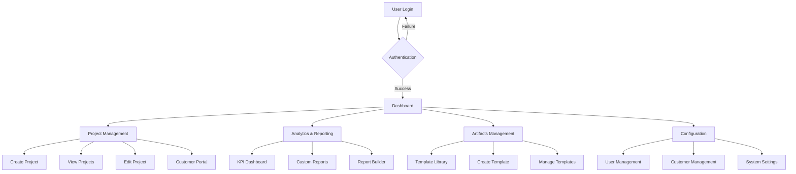

---

## 2. User Authentication & Authorization Flow

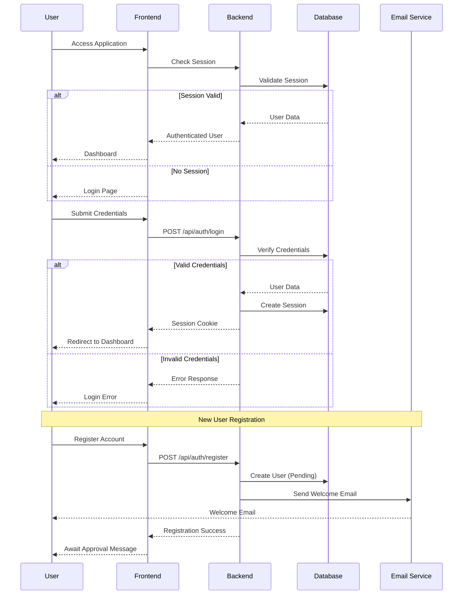

---

## 3. Project Creation & Management Workflow

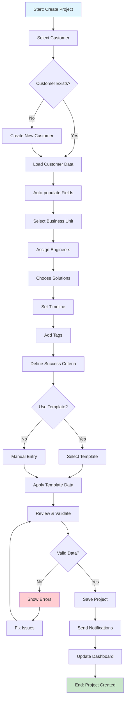

---

## 4. Success Criteria Management Flow

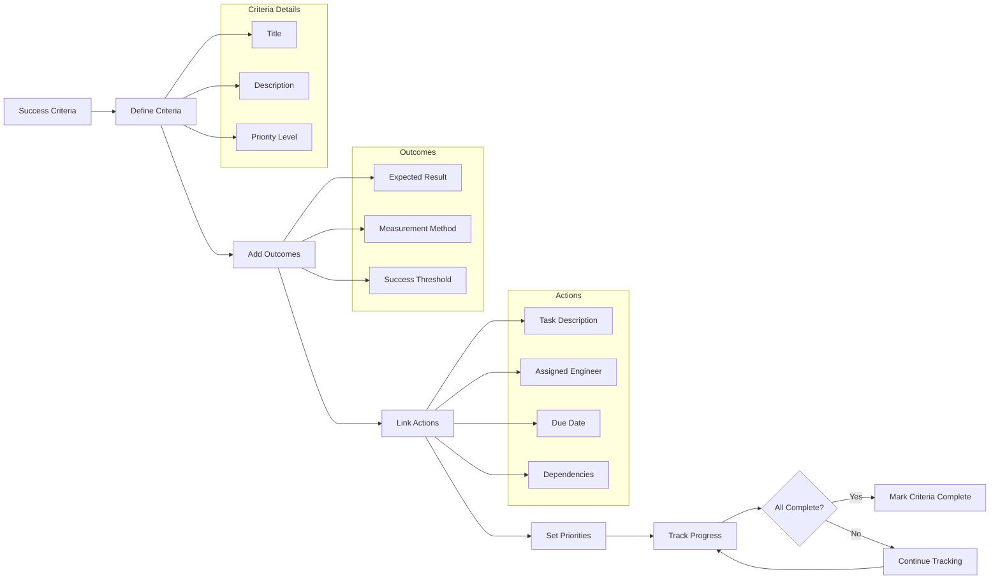

---

## 5. Template Creation & Application Workflow

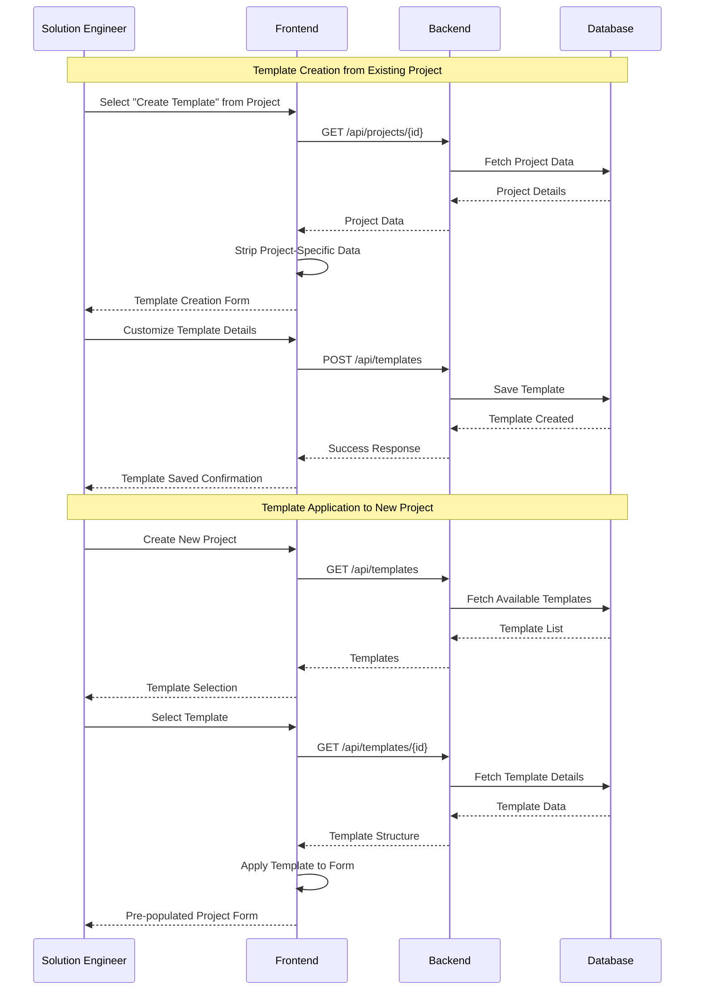

---

## 6. Customer Portal Access Flow

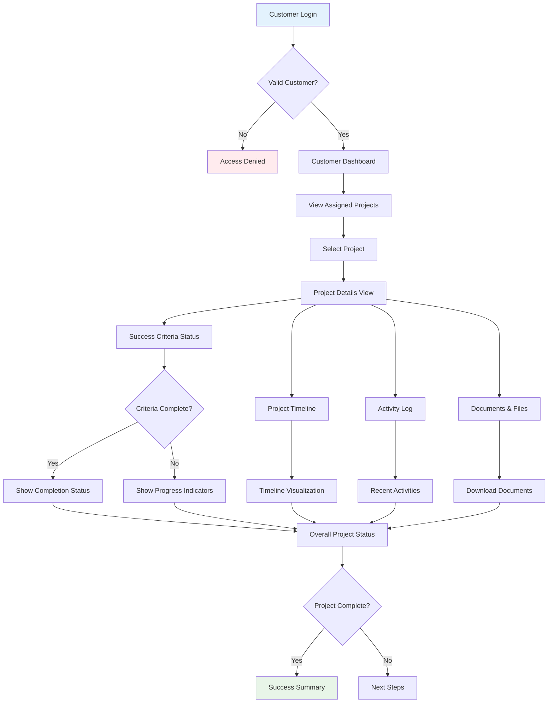

---

## 7. Analytics & Reporting Workflow

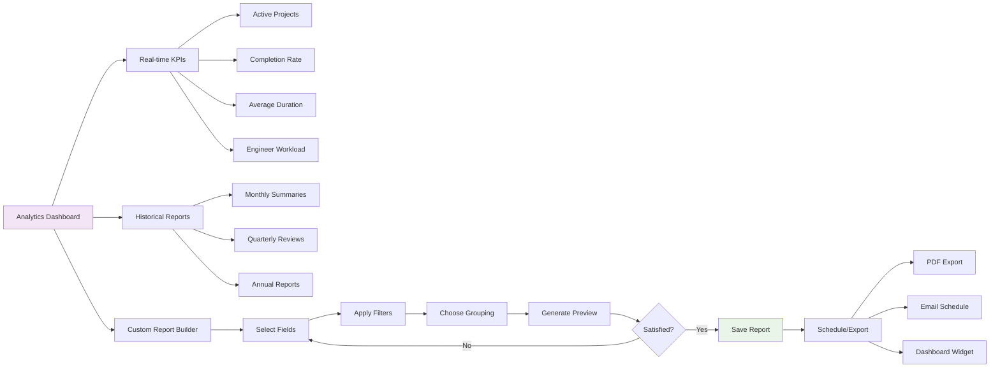

---

## 8. Data Flow Architecture

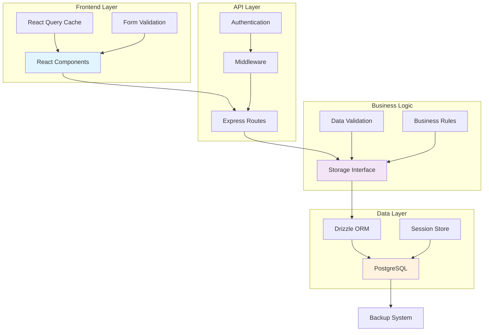

---

## 9. Error Handling & Recovery Flow

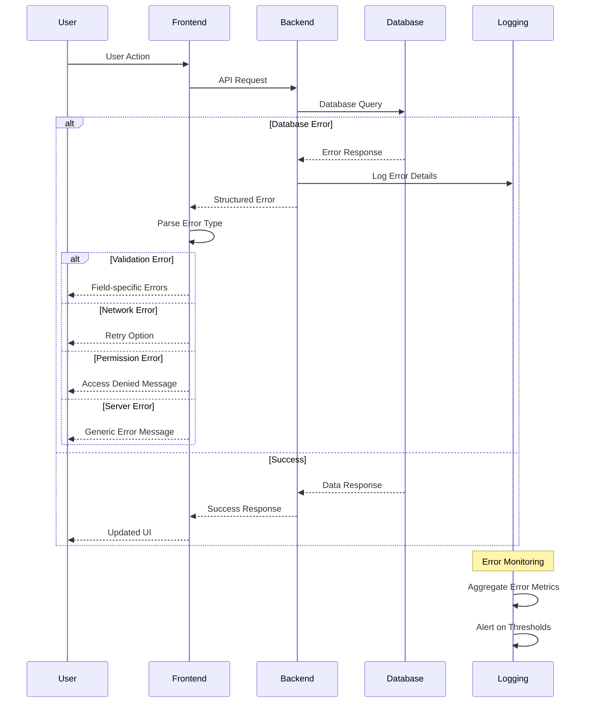

---

## 10. Real-time Update Flow (WebSocket)

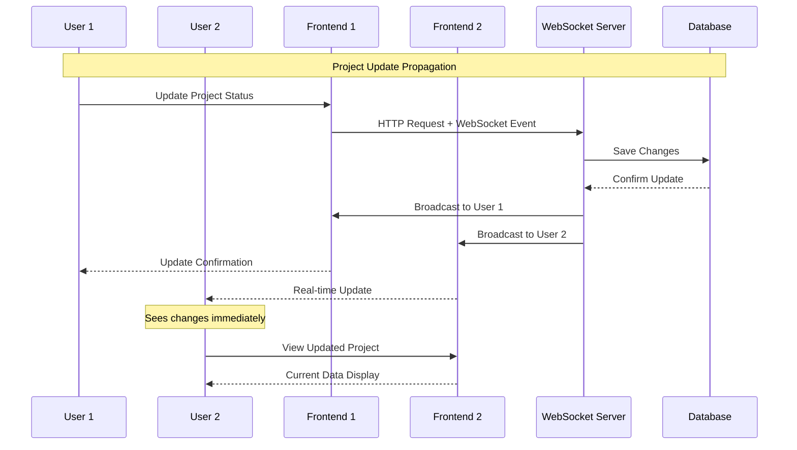

---

## 11. Configuration Management Flow

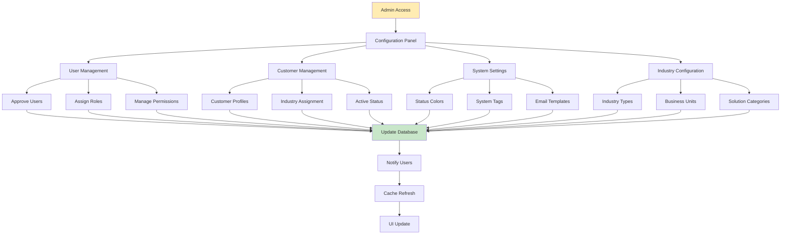

---

## 12. Performance Optimization Flow

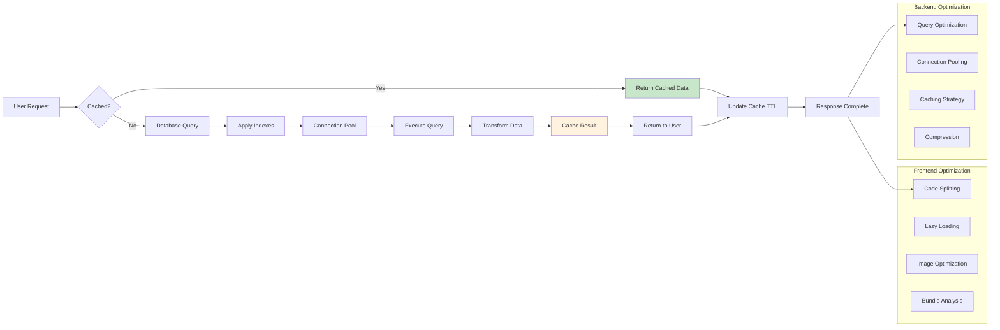

---

## Summary

These workflow diagrams illustrate the comprehensive nature of the CriteriaIQ Technical Validation Workspace system. The platform handles complex user interactions, data flows, and business processes while maintaining security, performance, and reliability standards.

Key workflow characteristics:
- **User-Centric Design:** Intuitive flows for all user types
- **Security-First:** Authentication and authorization at every step
- **Real-time Updates:** Live collaboration and status tracking
- **Error Resilience:** Comprehensive error handling and recovery
- **Performance Optimized:** Caching and optimization strategies
- **Scalable Architecture:** Modular design for future growth

*These diagrams are maintained alongside the application codebase and updated with each feature release.*