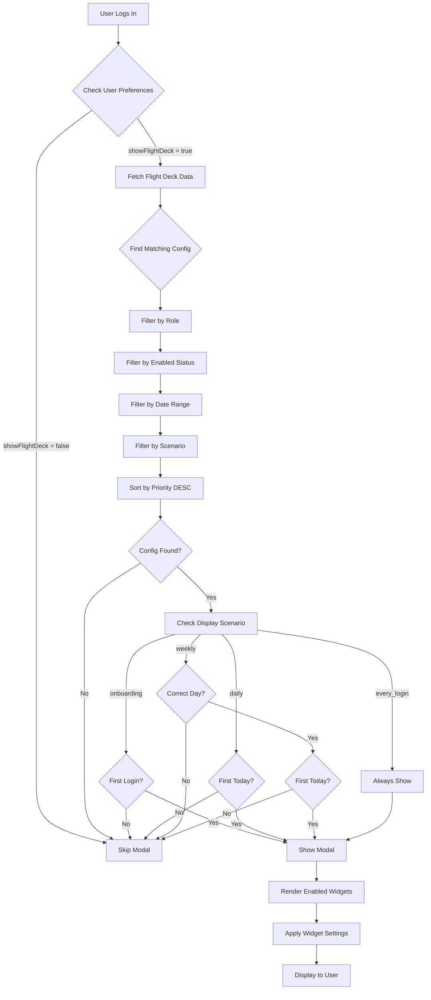
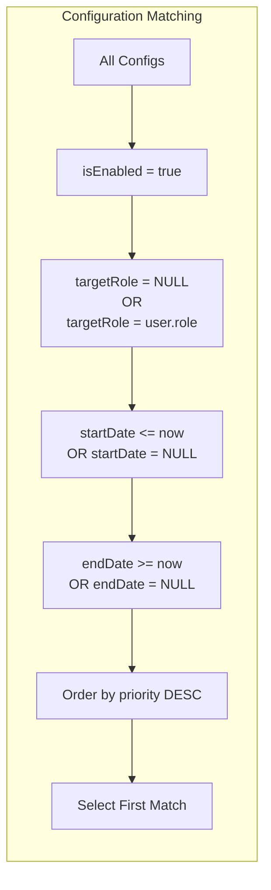
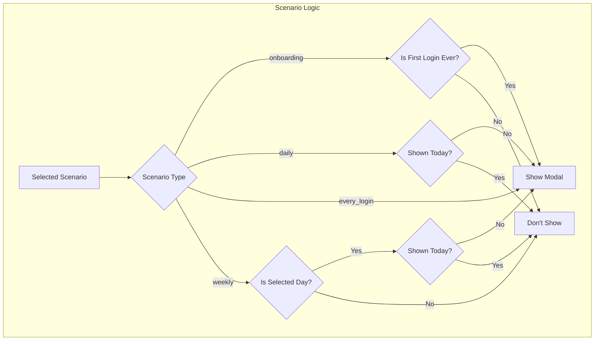

# Flight Deck Engine

## Overview

The Flight Deck Engine is a role-based welcome modal system that provides personalized, context-aware experiences for users when they access CriteriaIQ. It displays relevant widgets based on user role, display scenario, and configuration rules, helping users quickly understand their project health, risks, and next actions.

### Key Features

- **Role-Based Configuration**: Target specific user roles with customized experiences
- **Multiple Display Scenarios**: Onboarding, daily, every login, or weekly display modes
- **Priority-Based Rule Matching**: Higher priority configurations take precedence
- **Dynamic Widgets**: 5 configurable widgets with real-time data
- **Intelligent Data Validation**: Widgets only render when meaningful data exists
- **Drag-and-Drop Ordering**: Customize widget display sequence
- **Per-Widget Settings**: Fine-grained control over each widget's behavior
- **Configurable Tips System**: Display motivational tips in header or philosophy card
- **Visual Customization**: Header/footer images with flexible alignment options
- **Preview Functionality**: Test configurations before enabling

---

## Architecture

### System Flow



### Rule Matching Logic



### Display Scenario Decision Tree



---

## Database Schema

### flight_deck_configs

| Column | Type | Description |
|--------|------|-------------|
| `id` | serial | Primary key |
| `name` | text | Admin-friendly name |
| `targetRole` | varchar | Target role (NULL = all roles) |
| `scenario` | varchar | Display mode: 'onboarding', 'daily', 'every_login', 'weekly' |
| `selectedDays` | jsonb | Array of day numbers for weekly (0=Sunday, 6=Saturday) |
| `startDate` | timestamp | Optional start date |
| `endDate` | timestamp | Optional end date |
| `isEnabled` | boolean | Master on/off toggle |
| `priority` | integer | Higher = selected first when multiple match |
| `enabledWidgets` | jsonb | Array of widget keys in display order |
| `widgetSettings` | jsonb | Per-widget configuration object |
| `headerText` | text | Custom header greeting |
| `tipDisplayLocation` | varchar | 'none', 'header', or 'philosophy_card' |
| `headerImageUrl` | text | Optional header image URL |
| `headerImageAlignment` | varchar | 'left', 'center', or 'right' |
| `footerImageUrl` | text | Optional footer image URL |
| `footerImageAlignment` | varchar | 'left' or 'right' |
| `createdBy` | varchar | FK to users table |
| `createdAt` | timestamp | Creation timestamp |
| `updatedAt` | timestamp | Last modification timestamp |

### flight_deck_tips

| Column | Type | Description |
|--------|------|-------------|
| `id` | serial | Primary key |
| `tipText` | text | The tip content |
| `isActive` | boolean | Whether tip is available for display |
| `displayOrder` | integer | Order for rotation |
| `createdBy` | varchar | FK to users table |
| `createdAt` | timestamp | Creation timestamp |
| `updatedAt` | timestamp | Last modification timestamp |

---

## Widgets

Flight Deck includes 5 dynamic widgets that can be enabled, ordered, and configured per rule.

### 1. Health Pulse (`health_pulse`)

Displays project portfolio health metrics with configurable sections.

**Data Sources:**
- Project status distribution (Pending, Active, TCC, Closed, Stalled)
- Customer sentiment (Smooth, Friction, At Risk)
- Deal urgency by ranking
- Pipeline value (aggregated)
- Win rate percentage
- Active workload count

**Settings:**
```typescript
{
  showProcessStatus: boolean,    // Project status bar chart
  showCustomerSentiment: boolean, // Customer health badges
  showDealUrgency: boolean,      // Deal ranking breakdown
  showPipelineValue: boolean,    // Total pipeline value
  showWinRate: boolean,          // Win rate percentage
  showWorkload: boolean          // Active project count
}
```

**Data Validation:** Only renders if at least one metric has non-zero values.

### 2. Risk Radar (`risk_radar`)

Highlights attention-requiring projects and risk metrics.

**Data Sources:**
- Risk counts (Red, Yellow)
- Technical risk distribution (Red, Yellow, Green)
- Ranking counts (In Quarter, Burn It Down)
- High alert projects list
- Deadline counts (Ending Today, This Week, Overdue)
- Pending TCC count

**Settings:**
```typescript
{
  showRiskCounts: boolean,     // Risk level summary
  showRankingCounts: boolean,  // Deal ranking alerts
  showTechnicalRisk: boolean,  // Technical risk bar
  showDeadlines: boolean,      // Deadline warnings
  showPendingTcc: boolean,     // Pending TCC count
  highAlertLimit: number       // Max high-alert projects to show
}
```

**Data Validation:** Only renders if at least one risk metric has non-zero values.

### 3. One-Click Resume (`resume_button`)

Quick action to resume the most recently accessed project.

**Data Sources:**
- User's most recent project activity
- Project name and customer name

**Behavior:**
- Clicking navigates directly to the project page
- Only appears if user has project activity

### 4. Jumpstart Checklist (`jumpstart`)

Role-based onboarding tasks and quick actions with progress tracking.

**Preset Items:**
| Key | Label | Default Href |
|-----|-------|--------------|
| `profile` | Complete your profile | /profile |
| `security` | Enable two-factor authentication | /profile?tab=security |
| `firstProject` | Create your first project | /create |
| `firstMap` | Add a Mutual Action Plan | /project?tab=map-library |

**Item Types:**
- `preset`: Built-in checklist items with automatic completion detection
- `page`: Links to app pages with optional tab/subtab navigation
- `external`: External URLs (opens in new tab)
- `custom`: Custom labels with any href

**Settings:**
```typescript
{
  items: [
    {
      id: string,
      type: 'preset' | 'page' | 'external' | 'custom',
      key?: string,        // For preset items
      label: string,
      href?: string,
      pageId?: string,     // For page navigation
      tabId?: string,
      subtabId?: string,
      tooltip?: string,
      enabled: boolean,
      isExternal?: boolean
    }
  ]
}
```

### 5. Philosophy Card (`philosophy`)

Motivational content with optional tips and action links.

**Display Modes:**
- `static`: Shows first entry only
- `rotate`: Cycles through entries on each display

**Settings:**
```typescript
{
  mode: 'static' | 'rotate',
  entries: [
    {
      id: string,
      text: string,
      links?: [
        { label: string, href: string }
      ]
    }
  ]
}
```

**Tips Integration:** When `tipDisplayLocation` is set to `philosophy_card`, a random active tip from the tips table is displayed within this widget.

---

## Tips System

The Tips System provides configurable motivational or informational tips displayed to users.

### Display Locations

| Location | Behavior |
|----------|----------|
| `none` | Tips are disabled |
| `header` | Tip displays below the greeting in the modal header |
| `philosophy_card` | Tip displays within the Philosophy widget |

### Tip Selection

- Tips are randomly selected from active tips (`isActive = true`)
- Order by `displayOrder` when multiple tips are active
- New random tip selected on each modal display

### Default Tips

The system can be seeded with default tips:
1. "Small wins compound. Celebrate every validation milestone."
2. "The best POCs solve real problems, not imaginary ones."
3. "Technical validation is a conversation, not a checklist."
4. "Trust is built through transparency. Keep stakeholders informed."
5. "Every objection is an opportunity to demonstrate value."

---

## Display Scenarios

### Onboarding
- **Trigger**: User's first-ever login
- **Use Case**: Welcome new users, introduce platform features
- **Behavior**: Shows once, then never again

### Daily
- **Trigger**: First login of each calendar day
- **Use Case**: Daily briefing, project status updates
- **Behavior**: Shows once per day

### Every Login
- **Trigger**: Every successful authentication
- **Use Case**: Critical reminders, constant reinforcement
- **Behavior**: Shows on every page load

### Weekly
- **Trigger**: First login on specified days of the week
- **Use Case**: Weekly reviews, Monday kickoffs
- **Behavior**: Shows once per selected day
- **Configuration**: Select specific days (0=Sunday through 6=Saturday)

---

## API Reference

### Configuration Management

#### List All Configurations
```
GET /api/admin/flight-deck-configs
```
Returns all Flight Deck configurations ordered by priority (descending).

#### Create Configuration
```
POST /api/admin/flight-deck-configs
```
**Body:**
```json
{
  "name": "SE Daily Briefing",
  "targetRole": "Solution Engineer",
  "scenario": "daily",
  "isEnabled": true,
  "priority": 10,
  "enabledWidgets": ["health_pulse", "risk_radar", "resume_button"],
  "widgetSettings": { ... },
  "headerText": "Good morning!",
  "tipDisplayLocation": "header"
}
```

#### Update Configuration
```
PUT /api/admin/flight-deck-configs/:id
```

#### Delete Configuration
```
DELETE /api/admin/flight-deck-configs/:id
```

#### Preview Configuration
```
GET /api/admin/flight-deck-configs/:id/preview
```
Returns simulated Flight Deck data using the specified configuration.

### Tips Management

#### List All Tips
```
GET /api/admin/flight-deck-tips
```

#### Create Tip
```
POST /api/admin/flight-deck-tips
```
**Body:**
```json
{
  "tipText": "Your tip text here",
  "isActive": true,
  "displayOrder": 1
}
```

#### Update Tip
```
PUT /api/admin/flight-deck-tips/:id
```

#### Delete Tip
```
DELETE /api/admin/flight-deck-tips/:id
```

#### Seed Default Tips
```
POST /api/admin/flight-deck-tips/seed
```
Populates the database with default tips (only if no tips exist).

### User Endpoints

#### Get Flight Deck Data
```
GET /api/user/flight-deck-data
```
Returns personalized Flight Deck configuration and widget data for the current user.

**Response:**
```json
{
  "show": true,
  "reason": "Matched 'SE Daily Briefing' configuration",
  "config": { ... },
  "headerTip": "Small wins compound...",
  "data": {
    "healthPulse": { ... },
    "riskRadar": { ... },
    "resume": { ... },
    "jumpstart": { ... },
    "philosophy": { ... }
  },
  "user": {
    "firstName": "John",
    "lastName": "Doe"
  }
}
```

#### Update Flight Deck Preference
```
PUT /api/user/flight-deck-preference
```
**Body:**
```json
{
  "showFlightDeck": false
}
```
Allows users to disable Flight Deck via "Don't show again" option.

---

## Admin Guide

### Creating a Configuration

1. Navigate to **Configuration > Messaging & Alerts > Flight Deck**
2. Click **Add Configuration**
3. Fill in required fields:
   - **Name**: Descriptive identifier
   - **Target Role**: Select role or leave empty for all users
   - **Scenario**: Choose display frequency
   - **Priority**: Higher numbers take precedence
4. Enable desired widgets using the toggles
5. Drag widgets to reorder display sequence
6. Configure per-widget settings as needed
7. Set tip display location if using tips
8. (Optional) Add header/footer images
9. Click **Save**

### Widget Configuration Tips

**Health Pulse:**
- Disable metrics not relevant to the target role
- Pipeline Value and Win Rate require project data with deal values

**Risk Radar:**
- Set `highAlertLimit` to control how many projects are listed
- Enable deadline tracking for deadline-sensitive roles

**Jumpstart:**
- Remove preset items not applicable to experienced users
- Add custom page links for role-specific workflows
- External links open in new tabs

**Philosophy:**
- Use `rotate` mode to keep content fresh
- Add multiple entries for variety
- Include action links to relevant documentation

### Preview Functionality

Before enabling a configuration:
1. Click the **Preview** button on any configuration
2. The preview modal shows:
   - Simulated widget layout
   - Data availability badges (green = has data, orange = no data)
   - Visual representation of header/footer images
3. Widgets with no data display "No Data" badges in preview

### Best Practices

1. **Create role-specific configurations**: Different roles need different information
2. **Use appropriate scenarios**: 
   - `onboarding` for new hire welcome
   - `daily` for operational roles
   - `weekly` for management reviews
3. **Set meaningful priorities**: Ensure the most specific rule matches first
4. **Test with preview**: Verify layout before enabling
5. **Monitor user preferences**: If many users disable Flight Deck, review content relevance

---

## Example Configurations

### New User Onboarding
```json
{
  "name": "New User Welcome",
  "targetRole": null,
  "scenario": "onboarding",
  "priority": 100,
  "enabledWidgets": ["jumpstart", "philosophy"],
  "widgetSettings": {
    "jumpstart": {
      "items": [
        { "id": "profile", "type": "preset", "key": "profile", "label": "Complete your profile", "enabled": true },
        { "id": "security", "type": "preset", "key": "security", "label": "Enable MFA", "enabled": true },
        { "id": "firstProject", "type": "preset", "key": "firstProject", "label": "Create your first project", "enabled": true }
      ]
    },
    "philosophy": {
      "mode": "static",
      "entries": [
        { "id": "1", "text": "Welcome to CriteriaIQ! Let's get you started." }
      ]
    }
  },
  "headerText": "Welcome aboard!",
  "tipDisplayLocation": "none"
}
```

### Solution Engineer Daily Briefing
```json
{
  "name": "SE Daily Briefing",
  "targetRole": "Solution Engineer",
  "scenario": "daily",
  "priority": 50,
  "enabledWidgets": ["resume_button", "health_pulse", "risk_radar"],
  "widgetSettings": {
    "healthPulse": {
      "showProcessStatus": true,
      "showCustomerSentiment": true,
      "showDealUrgency": true,
      "showPipelineValue": false,
      "showWinRate": false,
      "showWorkload": true
    },
    "riskRadar": {
      "showRiskCounts": true,
      "showRankingCounts": true,
      "showTechnicalRisk": true,
      "showDeadlines": true,
      "showPendingTcc": true,
      "highAlertLimit": 5
    }
  },
  "tipDisplayLocation": "header"
}
```

### Manager Weekly Review
```json
{
  "name": "Manager Monday Review",
  "targetRole": "Manager",
  "scenario": "weekly",
  "selectedDays": [1],
  "priority": 40,
  "enabledWidgets": ["health_pulse", "risk_radar", "philosophy"],
  "widgetSettings": {
    "healthPulse": {
      "showProcessStatus": true,
      "showCustomerSentiment": true,
      "showDealUrgency": true,
      "showPipelineValue": true,
      "showWinRate": true,
      "showWorkload": true
    }
  },
  "headerText": "Your weekly team overview",
  "tipDisplayLocation": "philosophy_card"
}
```

---

## Troubleshooting

### Modal Not Appearing

1. **Check user preference**: User may have disabled Flight Deck
   - Query `users.showFlightDeck` column
2. **Verify configuration exists**: At least one enabled config must match
3. **Check role matching**: `targetRole` must match or be NULL
4. **Verify date range**: Current date must be within `startDate`/`endDate`
5. **Check scenario logic**: May have already shown for the period

### Widget Showing Empty

1. **Data validation**: Widgets with all-zero data are automatically hidden
2. **Check data source**: Verify user has associated projects
3. **Review widget settings**: Individual metrics may be disabled

### Wrong Configuration Displaying

1. **Check priorities**: Higher priority configs are selected first
2. **Review role targeting**: More specific role matches should have higher priority
3. **Verify date ranges**: Overlapping configs may conflict

---

## Related Documentation

- [System Announcements](./system-announcements.md) - Header bell and bottom banner notifications
- [Email Automation](./email-triggers-reference.md) - Automated email triggers and rules
