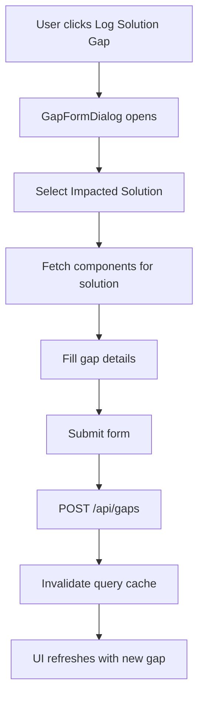
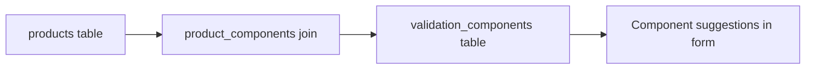

# Gap Analysis System

## Overview

The Gap Analysis system in CriteriaIQ enables Solution Engineers to identify, track, and manage solution limitations discovered during technical validation projects. It provides visibility into product gaps across customers and projects, enabling Product Management to prioritize roadmap decisions based on real customer feedback.

## Purpose

- **Capture Solution Gaps**: Document missing features, limitations, or workarounds identified during customer evaluations
- **Track Workarounds**: Record alternative approaches when native functionality doesn't meet requirements
- **Customer Rollup**: Aggregate gaps across customer accounts for Product Management visibility
- **Resolution Tracking**: Monitor gap status from identification through resolution

---

## Architecture

### Database Schema

The Gap Analysis system uses two primary tables:

#### Primary Gaps Table
```typescript
// shared/schema.ts
export const projectGaps = pgTable("project_gaps", {
  id: serial("id").primaryKey(),
  gapName: text("gap_name").notNull(),
  impactedSolution: text("impacted_solution").notNull(),
  impactedComponent: text("impacted_component"),
  gapType: text("gap_type").notNull(),
  status: text("status").notNull(),
  criticality: text("criticality").notNull(),
  description: text("description").notNull(),
  workaroundDetail: text("workaround_detail"),
  resolutionOwner: text("resolution_owner"),
  projectId: integer("project_id").references(() => projects.id),
  customerId: integer("customer_id").references(() => customers.id),
  reportedBy: varchar("reported_by").references(() => users.id),
  createdAt: timestamp("created_at").defaultNow(),
  updatedAt: timestamp("updated_at").defaultNow(),
});
```

#### Cross-Project Gap Links Table
```typescript
// shared/schema.ts
export const projectGapLinks = pgTable("project_gap_links", {
  id: serial("id").primaryKey(),
  projectId: integer("project_id").notNull().references(() => projects.id),
  gapId: integer("gap_id").notNull().references(() => projectGaps.id),
  linkedBy: varchar("linked_by").references(() => users.id),
  linkedAt: timestamp("linked_at").defaultNow(),
});
```

This table enables many-to-many relationships between projects and gaps, allowing gaps discovered in one project to be linked to other projects that share the same solution.

### Enumerations

```typescript
// Gap Types
export const GapTypeEnum = z.enum([
  "Feature",
  "Integration",
  "Performance", 
  "Scalability",
  "Documentation",
  "Other"
]);

// Gap Status
export const GapStatusEnum = z.enum([
  "Workaround Available",
  "Roadmap Candidate",
  "Won't Do"
]);

// Gap Criticality (MoSCoW Priority)
export const GapCriticalityEnum = z.enum([
  "Must Have",
  "Should Have",
  "Nice to Have"
]);

// Resolution Owner
export const GapResolutionOwnerEnum = z.enum([
  "Unassigned",
  "Engineering",
  "Product",
  "Support",
  "Customer"
]);
```

---

## Component Architecture

### File Locations

| Component | Path | Purpose |
|-----------|------|---------|
| GapFormDialog | `client/src/components/GapFormDialog.tsx` | Create/Edit gap modal dialog |
| GapDrawer | `client/src/components/GapDrawer.tsx` | Side drawer for project gaps |
| AddGapDrawer | `client/src/components/AddGapDrawer.tsx` | Link existing gaps from other projects |
| GapAnalysisTab | `client/src/components/project-detail/GapAnalysisTab.tsx` | Project detail tab content |
| Gap Analysis Page | `client/src/pages/gap-analysis.tsx` | Standalone gap management page |

### Icon Standard

All Gap Analysis features use the `AlignVerticalSpaceAround` icon from Lucide React for consistent visual identity throughout the application.

---

## User Interface Components

### 1. GapFormDialog

The primary form for creating and editing gaps. Features:

- **Gap Name**: Short, descriptive identifier for the gap (3-100 characters, required)
- **Impacted Solution**: Dropdown filtered to project's assigned solutions
- **Component/Module**: Combobox with:
  - Dropdown suggestions from Validation Criteria library
  - Free-text entry for custom components
  - Dynamic loading based on selected solution
- **Gap Type**: Categorization of the gap nature
- **Criticality**: MoSCoW priority assignment
- **Status**: Current resolution state
- **Description**: Detailed explanation of the gap
- **Workaround Detail**: Alternative approach documentation
- **Resolution Owner**: Responsible party assignment

### 2. GapDrawer

Side panel accessible from Project Board and Project Detail pages:

- Lists all gaps for a specific project
- Displays criticality badges with color coding
- Shows status indicators
- Provides quick "Log New Gap" action
- Navigates to full gap editing

### 3. AddGapDrawer

Side panel for linking existing gaps from other projects:

- **Solution Filtering**: Shows only gaps matching the current project's solutions
- **Expandable Details**: Collapsible sections reveal full gap information
- **Multi-select**: Checkbox selection for linking multiple gaps at once
- **Source Information**: Displays originating project and customer for each gap
- **Search**: Filter gaps by name or description

### 4. GapAnalysisTab

Full-featured tab within Project Detail view:

- Complete CRUD operations for project gaps
- Table view with sorting capabilities
- Inline actions (View, Edit, Delete, Unlink)
- Customer account linking
- **Cross-Project Gap Linking**: 
  - "Add Solution Gap" button opens AddGapDrawer
  - Linked gaps display "Linked" badge with source project info
  - Native gaps can be edited/deleted; linked gaps can only be unlinked
  - Unlink action removes the link without affecting the original gap

### 5. Gap Analysis Page

Standalone page (`/gap-analysis`) for cross-project gap management:

- Global view of all gaps across projects
- Advanced filtering by:
  - Solution
  - Status
  - Criticality
  - Customer
- Search functionality
- Direct project linking
- Bulk operations support

---

## Integration Points

### Project Integration

Gaps are tightly integrated with the Project system:

1. **Project Detail Page**: 
   - Toggle in Deliverables CardTitle enables gap logging
   - GapDrawer provides quick access to project gaps
   - Dedicated "Gap Analysis" tab for comprehensive management

2. **Project Board Page**:
   - "Log Solution Gap" button in header
   - Actions menu includes gap analysis option
   - GapDrawer accessible per project

### Solution Filtering

The system intelligently filters available solutions:

```typescript
// Case-insensitive partial matching for solution names
const availableProducts = projectContext?.solutions?.length
  ? allProducts.filter((product) =>
      projectContext.solutions.some((projectSolution) => {
        const productNameLower = product.name.toLowerCase().trim();
        const projectSolutionLower = projectSolution.toLowerCase().trim();
        return (
          productNameLower.includes(projectSolutionLower) ||
          projectSolutionLower.includes(productNameLower)
        );
      })
    )
  : allProducts;
```

### Component Dynamic Loading

Components are fetched based on selected solution:

```typescript
// API endpoint for component suggestions
GET /api/components?solutionId={id}

// Returns components linked to the solution via product_components table
```

### Sidebar Navigation

Gap Analysis appears in the sidebar under the "Projects" submenu group, accessible to authorized users.

---

## API Endpoints

### Gaps CRUD

| Method | Endpoint | Description |
|--------|----------|-------------|
| GET | `/api/gaps` | List all gaps (with query filters) |
| GET | `/api/gaps/:id` | Get single gap |
| POST | `/api/gaps` | Create new gap |
| PATCH | `/api/gaps/:id` | Update gap |
| DELETE | `/api/gaps/:id` | Delete gap |

### Project-Specific Gaps

| Method | Endpoint | Description |
|--------|----------|-------------|
| GET | `/api/projects/:id/gaps` | Get all gaps for a project |

### Component Suggestions

| Method | Endpoint | Description |
|--------|----------|-------------|
| GET | `/api/components?solutionId={id}` | Get components for a solution |

---

## Data Flow

### Creating a Gap



### Solution-to-Component Relationship



---

## Access Control

| Role | Can View | Can Create | Can Edit | Can Delete |
|------|----------|------------|----------|------------|
| Admin | All | Yes | All | All |
| Engineer | All | Yes | Own | Own |
| Sales | All | No | No | No |
| Customer | Project-specific | No | No | No |
| Guest | None | No | No | No |

---

## Color Coding

### Criticality Badges

| Level | Light Mode | Dark Mode |
|-------|------------|-----------|
| Must Have | Red background | Red 900 background |
| Should Have | Yellow background | Yellow 900 background |
| Nice to Have | Green background | Green 900 background |

### Status Badges

| Status | Light Mode | Dark Mode |
|--------|------------|-----------|
| Workaround Available | Blue background | Blue 900 background |
| Roadmap Candidate | Purple background | Purple 900 background |
| Won't Do | Gray background | Gray 700 background |

---

## Best Practices

### When to Log a Gap

1. **Feature Limitation**: Native functionality doesn't meet customer requirement
2. **Integration Missing**: Required third-party integration not available
3. **Performance Issue**: System doesn't meet scalability expectations
4. **Documentation Gap**: Missing or inadequate documentation

### Writing Effective Gap Descriptions

- Be specific about the use case
- Include customer context
- Describe expected vs. actual behavior
- Reference any relevant success criteria

### Workaround Documentation

- Provide step-by-step instructions
- Note any limitations of the workaround
- Include time/effort estimates
- Flag if workaround is sustainable long-term

---

## Related Documentation

- [MAP System Architecture](./map-system-architecture.md) - For project execution workflows
- [Salesforce Integration](./salesforce-system.md) - For CRM data enrichment
- [Email Automation System](./email-triggers-reference.md) - For gap-related notifications

---

## Version History

| Version | Date | Changes |
|---------|------|---------|
| 1.0 | December 2025 | Initial Gap Analysis system implementation |
| 1.1 | December 2025 | Added component combobox with solution-based filtering |
| 1.2 | December 2025 | Updated icon to AlignVerticalSpaceAround |
